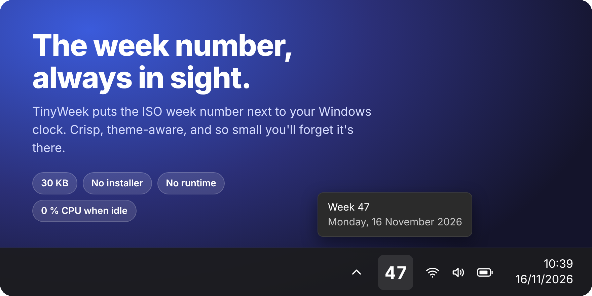
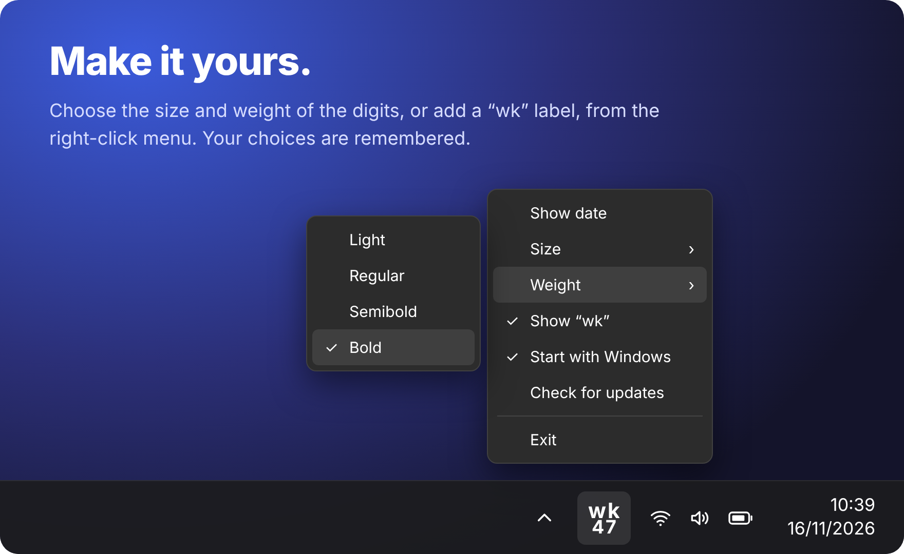
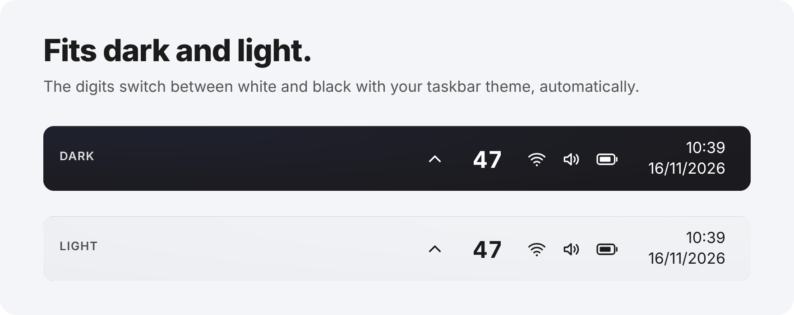

<p align="center">
  
</p>

<h1 align="center">TinyWeek</h1>

<p align="center">
  The week number in your Windows taskbar.<br>
  One small file. No installation needed.
</p>

<p align="center">
  <a href="../../releases/latest"><b>Download TinyWeek.exe</b></a>
</p>

<p align="center">
  
</p>

<p align="center">
  
</p>

<p align="center">
  
</p>

<sub>Images are illustrations of TinyWeek on a Windows 11 style taskbar.</sub>

## Features

- Shows the ISO week number (weeks start on Monday), as used in Europe.
- Large, sharp digits in your system font, white on a dark taskbar and black
  on a light one.
- Adjustable size and weight, and an optional "wk" label above the number.
- Starts with Windows if you want, and updates itself from the menu.
- Uses no CPU while idle and needs no admin rights.

## Install

### 1. Download

Click **[Download TinyWeek.exe](../../releases/latest)** and, on the page that
opens, click `TinyWeek.exe`. The file goes to your **Downloads** folder.

### 2. Move it to its own folder

Run it from a permanent place, not from Downloads. We recommend
`%LOCALAPPDATA%\Programs\TinyWeek`, which works without admin rights.

**With File Explorer:**

1. Press **Windows key + E** to open File Explorer.
2. Click the address bar at the top, type `%LOCALAPPDATA%\Programs` and press
   **Enter**.
3. Create a new folder named `TinyWeek` (right-click an empty area →
   **New** → **Folder**).
4. Move `TinyWeek.exe` from your Downloads folder into the new folder.
5. Double-click `TinyWeek.exe` to start it.

**Or with PowerShell** (does steps 1–5 in one go):

1. Open File Explorer (**Windows key + E**) and go to your **Downloads**
   folder.
2. Click the address bar, type `powershell` and press **Enter**. A blue or
   black PowerShell window opens in the Downloads folder.
3. Copy the lines below, right-click inside the PowerShell window to paste
   them and press **Enter**:

   ```powershell
   $dir = "$env:LOCALAPPDATA\Programs\TinyWeek"
   New-Item -ItemType Directory -Force $dir | Out-Null
   Move-Item .\TinyWeek.exe $dir -Force
   Start-Process "$dir\TinyWeek.exe"
   ```

4. Close the PowerShell window.

### 3. Windows may warn you the first time

TinyWeek is not signed with a paid code-signing certificate, so Windows may
show *"Windows protected your PC"*. Click **More info** → **Run anyway**. This
happens only once.

### 4. Show the icon on the taskbar (Windows 11)

Windows 11 hides new icons behind the **^** arrow next to the clock. To keep
the week number visible, do either:

- Click **^** and drag the week number onto the taskbar, or
- Right-click the taskbar → **Taskbar settings** → **Other system tray icons**
  and switch **TinyWeek** on.

### 5. Start it automatically

Right-click the week number and tick **Start with Windows**.

## Use

- **Hover** over the number to see the full date.
- **Double-click** to show the date in a window.
- **Right-click** for the menu:

| Menu item | What it does |
|---|---|
| Show date | Shows today's date and week |
| Size | Size of the number: 100 % (largest), 90 %, 80 % or 70 % |
| Weight | Thickness of the number: Light, Regular, Semibold or Bold |
| Show "wk" | Shows "wk" above the number |
| Start with Windows | Starts TinyWeek when you sign in |
| Check for updates | Downloads and installs a newer version if there is one |
| Exit | Closes TinyWeek |

Your choices are remembered. See [what's new](CHANGELOG.md) in each version.

## Update

Right-click the week number → **Check for updates**. If a newer version is
available, TinyWeek asks first, then downloads it, checks that the file is
intact, replaces itself and restarts. The question shows what has changed in
the new version. Your settings are kept.

If TinyWeek is in a folder that needs admin rights (such as
`C:\Program Files`), it opens the download page instead.

## Uninstall

1. Right-click the week number and untick **Start with Windows**.
2. Choose **Exit**.
3. Delete the `TinyWeek` folder (in File Explorer, go to
   `%LOCALAPPDATA%\Programs`).
4. To remove saved settings as well: press **Windows key**, type `powershell`,
   press **Enter**, paste this line and press **Enter**:

   ```powershell
   Remove-Item HKCU:\Software\TinyWeek -ErrorAction SilentlyContinue
   ```

## FAQ

**Can the week number go inside the Windows clock?** No. Windows has no
supported way to add text to the clock, so TinyWeek uses its own icon next to
it.

**Does it connect to the internet?** Only when you choose **Check for
updates**, and then only to GitHub. No automatic checks, no tracking.

**Which Windows versions?** Windows 10 and 11.

## Build from source

Requires MinGW-w64. On Linux:

```bash
sudo apt install gcc-mingw-w64-x86-64
./build.sh
```

On Windows, use the MSYS2 UCRT64 shell: `pacman -S mingw-w64-ucrt-x86_64-gcc`,
then `CROSS= ./build.sh`. The result is `build/TinyWeek.exe`.

To publish a release, add a `## <version>` section to `CHANGELOG.md`, change
the number in `VERSION` and push to `main`. GitHub Actions builds the exe and
publishes it with its SHA-256 checksum, using the changelog section as the
release notes. Without that section the release is not published.

## License

[MIT](LICENSE)
